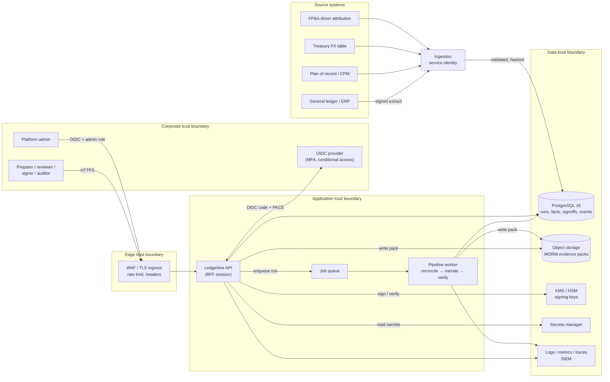
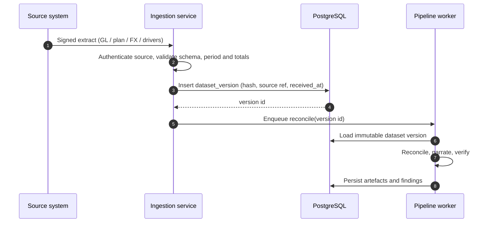

# Data-flow model — Ledgerline production target

**Status:** Accepted — 2026-11-15 (decision owner)
**Scope:** one single-tenant deployment (ADR-001)
**Related:** ADR-002 identity, ADR-003 data store, ADR-004 runtime

## 1. Data classification

| Class | Examples | Handling |
| --- | --- | --- |
| Restricted — signing material | KMS/HSM keys, database credentials, OIDC client secret | Never exportable; secrets manager/KMS; no logs |
| Confidential — financial | Journal lines, trial balance, plan, FX, variances, commentary, evidence packs | TLS in transit; encryption at rest; least-privilege access; no lower-environment copies |
| Integrity-critical | Sign-offs, attestations, chain links, event stream, dataset hashes | Append-only, WORM archive, KMS signature, long retention |
| Personal | Signer/preparer name, email, subject id, IP/user agent | Minimise; role-based access; retention aligned to audit policy |
| Operational | Logs, metrics, traces, job metadata | Redacted; access-controlled; shorter retention |

## 2. Context diagram



## 3. Trust boundaries

| Boundary | Crossing | Primary controls |
| --- | --- | --- |
| Internet/corporate → edge | User HTTPS | TLS 1.2+, WAF, rate limit, trusted host, security headers |
| Edge → app | Requests with session | OIDC session validation, CSRF, RBAC, body limits |
| App → IdP | Auth code, token exchange | PKCE, state/nonce, issuer/audience validation, JWKS |
| App → Postgres | SQL over TLS | Least-privilege role, TLS verification, connection pool |
| App → KMS | Sign/verify | Key policy, workload identity, no key export |
| App → object storage | Evidence packs | Private bucket, WORM, signed access, pack hash |
| Ingestion → source | Source extracts | Service identity/mTLS, allowlist, schema validation, hash |
| Admin/CI → deployment | Images, migrations | OIDC federation, approvals, signed images, audit |
| App → SIEM/logs | Operational telemetry | Redaction, separate retention, access control |

## 4. Ingestion flow



Controls:

- Reject missing, late, duplicated or schema-invalid extracts; never fall back to
  synthetic seed data.
- Record the source reference, extract hash, row counts and validation results.
- Make the dataset version immutable; a correction creates a new version.
- Reconcile against source control totals before a run is allowed to proceed.

## 5. Run creation and review

```mermaid
sequenceDiagram
    autonumber
    participant U as Preparer
    participant A as API (BFF)
    participant Q as Queue
    participant W as Worker
    participant PG as PostgreSQL

    U->>A: POST /api/runs (period, mode)
    A->>A: Authorize preparer role; derive subject from session
    A->>Q: Enqueue run (idempotency key)
    A-->>U: 202 Accepted + job id
    Q->>W: Run pipeline
    W->>PG: Recon facts, variances, controls
    W->>PG: Commentary claim plan (facts only)
    W->>PG: Verification report + findings
    U->>A: GET /api/jobs/{id}
    A-->>U: status and links to workpaper
    U->>A: Review findings, open fact drawer
```

The preparer cannot type figures; the engine inserts them from the fact store.
The preparer may regenerate commentary or re-verify before signing.

## 6. Sign-off flow

```mermaid
sequenceDiagram
    autonumber
    participant S as Signer
    participant A as API
    participant PG as PostgreSQL
    participant K as KMS/HSM
    participant O as WORM storage
    participant T as Timestamp authority

    S->>A: POST /api/runs/{id}/signoff + attestations + CSRF
    A->>A: Validate session, role, SoD (subject != preparer)
    A->>PG: BEGIN SERIALIZABLE; lock chain tail
    A->>PG: Validate gate, coverage, attestation templates
    A->>K: Sign canonical sign-off payload
    K-->>A: signature + key id
    A->>T: Request RFC 3161 timestamp
    T-->>A: timestamp token
    A->>PG: Insert signoff, attestations, event; update run status
    A->>PG: COMMIT
    A->>O: Write evidence pack (pack id + hash) under Object Lock
    A-->>S: Signed certificate
```

Controls:

- One transaction for sequence, sign-off, event and run status.
- The signer identity comes from the session, never the request body.
- A dual-control exception must be an approved policy record.
- The KMS signature covers the chain payload, including engine/verifier versions,
  preparer/signer subjects and attestation details.
- The timestamp token is stored with the pack; the offline verifier checks the
  signature and timestamp without the production database.

## 7. Export and audit flow

1. Auditor requests an evidence pack. The API checks `auditor`/`signer` role and
   records an `audit_exported` event with subject, pack id and hash.
2. The pack is read from WORM storage or regenerated deterministically, then
   streamed; the per-download `pack_hash` is returned in the manifest.
3. The auditor runs the offline verifier: recompute `pack_hash`, verify the KMS
   signature with the published key, verify the RFC 3161 token, then re-derive
   each fact from the pack's journal extract.
4. Chain and export access logs go to the SIEM, not only the application DB.

## 8. Data stores

| Store | Data | Protection | Retention |
| --- | --- | --- | --- |
| PostgreSQL | Runs, artefacts, facts, variances, findings, sign-offs, events, policies, dataset versions | TLS, encryption at rest, least privilege, PITR, append-only roles | Seven years or engagement policy; archive closed periods |
| Object storage | Evidence packs, signed manifests, timestamp tokens, archived exports | WORM/Object Lock, private bucket, KMS key, pack hash | Same as audit record |
| KMS/HSM | Signing and encryption keys | Non-exportable, key policy, rotation, audit logs | Public keys retained for verification |
| Secrets manager | DB password, OIDC secret, service credentials | Rotation, access audit, no git | Rotated on schedule/incident |
| SIEM/log store | Security and access events | Redaction, access control, immutable retention | Per security policy |

## 9. Network flows

| From | To | Port/Protocol | Control |
| --- | --- | --- | --- |
| User | Ingress | 443/TLS | WAF, OIDC, rate limit |
| Ingress | API | 8080/HTTP inside private network | Network policy, no public exposure |
| API/worker | PostgreSQL | 5432/TLS | Private subnet, certificate verification |
| API/worker | OIDC provider | 443/TLS | Egress allowlist |
| API/worker | KMS, secrets manager | 443/TLS | Workload identity, private endpoint |
| API/worker | Object storage | 443/TLS | Private endpoint, scoped role |
| Ingestion | Source systems | Approved APIs/SFTP | Service identity, allowlist, schema validation |
| API/worker | OTel/SIEM | 443/TLS | Redaction, buffering |

No database, object store or KMS endpoint is reachable from the public internet.

## 10. Failure and degradation rules

| Failure | Required behaviour |
| --- | --- |
| Dataset missing/stale | Readiness fails; run creation refused with a clear 503; never seed synthetic data |
| OIDC unavailable | Existing sessions continue until expiry; new logins fail closed; break-glass is audited |
| KMS unavailable | Sign-off and verification fail closed; reads continue |
| PostgreSQL unavailable | Readiness fails; no writes; queue pauses |
| Object storage unavailable | Sign-off may complete in the DB, but the pack is marked pending and retried; alert |
| Chain verification fails | Sign-off blocked; incident raised; no automatic repair |
| Queue backlog | Backpressure and alerts; no unbounded worker growth |

## 11. Data lineage and evidence

For every figure the system retains:

- the source dataset version and extract hash;
- the journal line ids, plan row, FX rate and driver legs used in the derivation;
- the fact id and its canonical value;
- the commentary section and rendered token;
- the verification result and finding ids;
- the sign-off id, signer subject, engine/verifier versions and pack hash.

This lineage is what makes an evidence pack independently re-derivable and is
carried into the threat model as an integrity asset.
